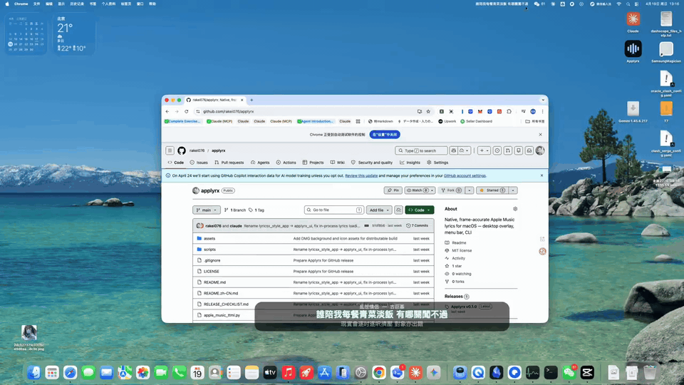

# Applyrx

**Applyrx v0.2.5 — Menu Bar Glass Lyrics**

Applyrx is an unofficial macOS menu bar lyrics app for Apple Music. It reads
timed lyrics from Apple Music's local cache and shows them in a translucent
glass capsule under the menu bar while music plays.

This project is based on and inspired by the MIT-licensed
[Applyrx](https://github.com/rakei076/applyrx) project. It is an independent,
unofficial third-party tool and is not affiliated with, endorsed by, or
sponsored by Apple.

## Demo



[Download the silent MP4 demo](./assets/applyrx-demo.mp4).

## Features

- A single ♪ item in the menu bar. **While Apple Music plays, a translucent glass
  lyric capsule appears by itself** (current line + next line) and disappears
  when playback pauses or Music quits. No clicks, no hovering.
- Native macOS 26 **Liquid Glass** (`NSGlassEffectView`, clear style): the capsule
  lets the content behind it show through, and it is **click-through**.
- Black lyric text with a light halo, readable over light windows and dark ones.
- Between lyric lines the current line stays visible until the next line starts.
- Strict matching against the current track; no guessing from incomplete or
  conflicting metadata, with a retry of the local lookup on a first miss.
- Reuses scan/parse results while the cache is unchanged and distinguishes the
  common failure reasons.
- Launch at login (toggle in the menu).
- Minimal menu: version / launch at login / quit.

## Requirements

- **macOS 26.0 or newer.** The lyrics panel is a native SwiftUI panel that uses
  `NSGlassEffectView`, which requires macOS 26.
- **Apple Silicon Mac.** The native lyrics panel is built for `arm64` only; Intel
  Macs are not supported by the current release.
- Apple Music.app with lyrics already present in its local cache. Opening the
  built-in lyrics view in Music may be necessary to populate local cache data.
- macOS Automation permission for reading the current Apple Music track.
- Python 3.10 or newer, but **only** when building from source. The v0.2.5 release build uses Python 3.12.5.

## Installation

Download the release asset `Applyrx-v0.2.5-macOS.zip` from the GitHub Releases
page, unzip it, and move `Applyrx.app` to your Applications folder (or run it
from anywhere).

### First launch

The current macOS release is **ad-hoc signed only**. It is **not signed with an
Apple Developer ID** and **not notarized**, so macOS Gatekeeper may report that
it cannot verify the developer.

To open it:

1. In Finder, right-click (or Control-click) `Applyrx.app`.
2. Choose **Open**.
3. Confirm **Open** in the dialog that macOS shows.

Alternatively, allow it once under **System Settings → Privacy & Security** after
the first blocked launch ("Open Anyway"). Because the app is not notarized, it
does not carry an Apple-verified developer identity; only install it if you are
comfortable running an unsigned build you obtained from this repository.

## Build

Build a macOS app bundle from source with:

```bash
./scripts/build_app.sh
open dist/Applyrx.app
```

The build compiles `native/ApplyrxLyricsPanel.swift` for
`arm64-apple-macos26.0` using the macOS 26.5 Command Line Tools SDK (override with
the `MACOS_SDK` environment variable), then packages `dist/Applyrx.app` with
py2app. The build scripts use an installed compatible Python interpreter and do
not modify system Python; set `APPLYRX_PYTHON` to select a specific interpreter.

To produce the release archive and its checksum:

```bash
./scripts/release_macos.sh
# → Applyrx-v0.2.5-macOS.zip
# → Applyrx-v0.2.5-macOS.zip.sha256
```

`scripts/release_macos.sh` verifies the version metadata, the minimum system
version, the architecture, and that no build-machine path or user data is inside
the bundle before packaging. It never runs `git commit`, `git tag`, `git push`,
or any GitHub release step.

## Development and Testing

Run the Python test suite from the repository root:

```bash
./venv/bin/python -m unittest \
  tests.test_build_environment \
  tests.test_lyrics_panel \
  tests.test_lyrics_provider \
  tests.test_lyrics_sync \
  tests.test_menubar_lyrics \
  tests.test_music_cache_diagnostic \
  tests.test_music_lifecycle \
  tests.test_no_fixed_home_path \
  tests.test_playback_visibility \
  tests.test_word_timing_diagnostic
# expected: Ran 264 tests — OK
```

`tests/` intentionally has no `__init__.py`, so `python -m unittest discover` is
not available; use the explicit module list above (or a single module, for
example `./venv/bin/python -m unittest tests.test_lyrics_sync`).

Run the native panel self-test:

```bash
./scripts/build_app.sh
./build/ApplyrxLyricsPanel --self-test
# expected: 53 self-test checks, all true
```

Check the diff for whitespace errors before committing:

```bash
git diff --check
```

## Usage

1. Launch Applyrx; a ♪ icon appears in the menu bar.
2. Play a song in Apple Music. The lyric capsule shows up under the ♪ icon and
   updates line by line.
3. Pause Music or quit it — the capsule hides by itself.
4. If a song has no lyrics yet, open its built-in lyrics view in Music so the
   local cache updates; Applyrx retries the local lookup.

## Architecture

```text
Apple Music.app
      │ read current track metadata and playback position
      ▼
CurrentTrackManager ──▶ AppleMusicCacheProvider
                              │ read-only
                              ▼
                 Cache.db + fsCachedData
                              │
                 catalog/song cache response
                              │ strict identity and metadata matching
                              ▼
             syllable-lyrics TTML ──▶ TTMLParser
                                           │ timed lines / available word timing
                                           ▼
                                     LyricsEngine
                                           │
                             Python panel bridge (JSON over stdin)
                                           ▼
                       SwiftUI Liquid Glass panel + Settings
                                           │
                    single lyric track + clipped viewport + offset
```

The overlay uses Music's reported playback position as its synchronization
reference. Lyrics are sourced from cached catalog/song responses containing
Apple Music's `syllable-lyrics` extension; Applyrx does not ask a third-party
lyrics service to identify or provide lyrics.

## Apple Music data source

- Applyrx reads Apple Music's local `Cache.db` **read-only** plus the associated
  `fsCachedData` response bodies, and parses the cached `syllable-lyrics` TTML
  into timed lines and word timing.
- Applyrx reads the current track metadata and playback position from Music.app.
  It does not send playback control commands.
- Applyrx does **not** read an Apple ID password, cookies, or authentication
  tokens.
- There is **no cloud lyrics API**: lyric lookup is local-only, and no track
  information or lyric content is uploaded anywhere.
- Appearance preferences and the optional panel position are stored in the
  macOS user defaults domain `com.applyrx.desktoplyrics`. Legacy app preferences
  remain under `~/.applyrx`. Neither location stores Apple Music credentials.

## Limitations

- Lyrics are shown only while Apple Music is **playing**: pause, stop or quit
  hides the capsule.
- The capsule is anchored under the ♪ item; its position is not configurable.
- macOS 26 (Liquid Glass) and Apple Silicon only.
- Depends on lyrics in Apple Music's local cache; songs without cached lyrics
  cannot be displayed.
- Strict matching: no lyrics is preferred over guessing.

## Troubleshooting

**No lyric capsule.** Make sure Apple Music is actually playing (not paused) and
that the ♪ item exists in the menu bar. The first match for a song can take a
second or two.

**A song never shows lyrics.** Open its built-in lyrics view in Music, let the
local cache update, and try again; Applyrx retries the local lookup.

**The capsule covers something.** It is click-through and only 60pt tall; pause
the music to hide it.

**The app is not running.** Check for the ♪ item; if it is missing, open
Applyrx again.

## Release status

- Release asset: `Applyrx-v0.2.5-macOS.zip` with `Applyrx-v0.2.5-macOS.zip.sha256`.
- Signing: ad-hoc (`codesign -s -`), no Developer ID, `TeamIdentifier` not set.
- Notarization: not notarized.
- Distribution: GitHub Releases only. There is no App Store release.

## Roadmap

- Improve release distribution and Developer ID signing/notarization.
- Improve cache compatibility diagnostics while preserving strict matching.

## Contributing

Issues and pull requests are welcome. Please avoid including Apple Music cache
files, personal configuration, credentials, or logs containing private data in
bug reports. Changes must preserve read-only cache access, local lyric lookup,
and strict track matching.

## License

Applyrx is distributed under the MIT License. See [LICENSE](./LICENSE) for the
original copyright and license text.

## Disclaimer

Applyrx is an unofficial third-party project. Apple Music, Apple, and macOS are
trademarks of Apple Inc. This project is not affiliated with or endorsed by
Apple. Compatibility with Apple Music and macOS is not guaranteed and may
change as those products evolve.
