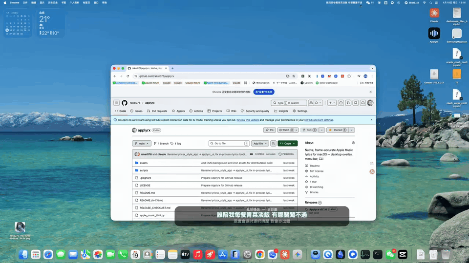

# Applyrx

**Applyrx v0.2.5 —— 菜单栏玻璃歌词**

Applyrx 是一款面向 Apple Music 的非官方 macOS 菜单栏歌词工具。它从 Apple Music
本地缓存读取带时间戳的歌词，在播放时于菜单栏下方自动显示透明玻璃歌词胶囊。

本项目基于并受 MIT 许可的
[Applyrx](https://github.com/rakei076/applyrx) 项目启发，是独立的非官方第三方
工具，与 Apple 无关联，也未获得 Apple 的认可或赞助。

## 演示



[下载无声 MP4 演示视频](./assets/applyrx-demo.mp4)。

## 功能

- 菜单栏常驻一个 ♪ 图标，**播放音乐时自动显示玻璃歌词胶囊**（当前句 + 下一句），
  暂停或退出 Apple Music 时自动消失，不需要点击或悬停。
- 胶囊使用 macOS 26 原生 **Liquid Glass**（`NSGlassEffectView`，clear 样式）：透明
  玻璃透出背后内容，**点击穿透**，不挡任何操作。
- 黑色歌词文字 + 浅色光环阴影，亮色窗口和深色背景都保持可读。
- 歌词行之间的间隙保持显示当前句，直到下一句起始时间到达。
- 严格匹配当前歌曲；不根据不完整或冲突的元数据猜测；首次未匹配时会重试本地缓存查询。
- 缓存内容未变化时复用扫描与解析结果，并区分常见的歌词识别失败原因。
- 开机自启动（菜单里可开关）。
- 菜单极简：版本号 / 开机自启动 / 退出。

## 环境要求

- **macOS 26.0 或更新版本。** 歌词浮窗是原生 SwiftUI 面板，使用
  `NSGlassEffectView`，需要 macOS 26。
- **Apple Silicon Mac。** 原生歌词面板仅以 `arm64` 构建，当前版本不支持 Intel Mac。
- 安装 Apple Music.app，且本地缓存中已有该歌曲的歌词。必要时可在 Music 中打开
  内建歌词面板以产生本地缓存。
- macOS 自动化权限，以便读取 Music.app 当前曲目信息。
- Python 3.10 或更新版本，但**仅用于从源码构建**。v0.2.5 Release 使用 Python 3.12.5 构建。

## 安装

从 GitHub Releases 页面下载发布资源 `Applyrx-v0.2.5-macOS.zip`，解压后把
`Applyrx.app` 拖到"应用程序"文件夹（也可以就地运行）。

### 首次打开

当前 macOS 发布包**只做了 ad-hoc 签名**：**没有 Apple Developer ID 签名**，也
**没有经过公证**，因此 macOS Gatekeeper 可能提示无法验证开发者。

打开方式：

1. 在访达中右键（或按住 Control 点击）`Applyrx.app`。
2. 选择"打开"。
3. 在随后弹出的对话框中再次确认"打开"。

也可以在首次被拦截后，前往**系统设置 → 隐私与安全性**，选择"仍要打开"放行一次。
由于没有公证，应用不携带 Apple 验证过的开发者身份；请仅在你愿意运行这个由本仓库
提供的未签名构建时安装它。

## 构建

从源码构建 macOS App：

```bash
./scripts/build_app.sh
open dist/Applyrx.app
```

构建流程会为 `arm64-apple-macos26.0` 编译 `native/ApplyrxLyricsPanel.swift`（使用
macOS 26.5 Command Line Tools SDK，可用环境变量 `MACOS_SDK` 覆盖），再用 py2app
打包为 `dist/Applyrx.app`。脚本会使用本机已安装的兼容 Python，不会修改系统
Python；必要时可通过 `APPLYRX_PYTHON` 指定解释器。

生成发布压缩包及其校验和：

```bash
./scripts/release_macos.sh
# → Applyrx-v0.2.5-macOS.zip
# → Applyrx-v0.2.5-macOS.zip.sha256
```

`scripts/release_macos.sh` 会在打包前校验版本信息、最低系统版本、架构，并确认
bundle 内不含构建机路径与用户数据。它**不会**执行 `git commit`、`git tag`、
`git push` 或任何 GitHub Release 操作。

## 开发与测试

在仓库根目录运行 Python 测试：

```bash
./venv/bin/python -m unittest \
  tests.test_build_environment \
  tests.test_lyrics_panel \
  tests.test_lyrics_provider \
  tests.test_lyrics_sync \
  tests.test_menubar_lyrics \
  tests.test_music_cache_diagnostic \
  tests.test_music_lifecycle \
  tests.test_no_fixed_home_path \
  tests.test_playback_visibility \
  tests.test_word_timing_diagnostic
# 预期：Ran 264 tests — OK
```

`tests/` 中没有 `__init__.py`，因此 `python -m unittest discover` 不可用；请使用上面
的显式模块列表（或单个模块，例如 `./venv/bin/python -m unittest tests.test_lyrics_sync`）。

运行原生面板自检：

```bash
./scripts/build_app.sh
./build/ApplyrxLyricsPanel --self-test
# 预期：53 项自检全部为 true
```

提交前检查空白字符问题：

```bash
git diff --check
```

## 使用

1. 启动 Applyrx，菜单栏出现 ♪ 图标。
2. 在 Apple Music 播放歌曲——歌词胶囊会自动出现在 ♪ 下方并逐句更新。
3. 暂停或退出 Apple Music，胶囊自动消失。
4. 若某首歌没有歌词：在 Music 中打开该歌曲的内建歌词页，等待本地缓存更新；
   Applyrx 会重试本地查询。

## 架构

```text
Apple Music.app
      │ 只读当前歌曲元数据和播放位置
      ▼
CurrentTrackManager ──▶ AppleMusicCacheProvider
                              │ 只读
                              ▼
                 Cache.db + fsCachedData
                              │ 严格身份及元数据匹配
                              ▼
             syllable-lyrics TTML ──▶ TTMLParser
                                           │ 定时歌词行 / 可用的逐字时间
                                           ▼
                                     LyricsEngine
                                           │
                             Python 面板桥接（stdin 上的 JSON）
                                           ▼
                    菜单栏歌词胶囊（AppKit NSGlassEffectView）
                                           │
                 播放时自动显示 / 暂停或退出 Music 自动隐藏
```

胶囊以 Music 报告的播放位置作为同步参考。歌词来自本地缓存中带有 Apple Music
`syllable-lyrics` 扩展的歌曲目录响应；Applyrx 不会向第三方歌词服务请求歌曲识别
或歌词内容。原生 Swift 面板进程仍作为歌词引擎运行，但窗口不再显示。

## Apple Music 数据来源

- Applyrx 以**只读**方式访问 Apple Music 本地 `Cache.db` 及关联的 `fsCachedData`
  响应内容，并把缓存中的 `syllable-lyrics` TTML 解析为定时歌词行和逐字时间。
- Applyrx 从 Music.app 读取当前曲目元数据和播放位置，不发送播放控制命令。
- Applyrx **不**读取 Apple ID 密码、cookie 或认证 token。
- **没有云端歌词 API**：歌词查询完全在本地完成，不会上传曲目信息或歌词内容。
- 外观偏好和可选浮窗位置保存在 macOS 用户默认值域 `com.applyrx.desktoplyrics`。
  旧版应用偏好仍保存在 `~/.applyrx`。两处都不会保存 Apple Music 凭据。

## 限制

- 歌词只在 Apple Music **播放时**显示：暂停、停止或退出 Music 会隐藏胶囊。
- 胶囊位置固定在菜单栏 ♪ 图标下方，不提供拖动或自定义位置。
- 仅支持 macOS 26（Liquid Glass 需要）与 Apple Silicon。
- 依赖 Apple Music 本地缓存中的歌词；缓存里没有的歌曲无法显示歌词。
- 严格匹配当前歌曲，宁可无歌词也不猜。

## 故障排查

**没有看到歌词胶囊。** 确认 Apple Music 正在播放（不是暂停），并检查菜单栏的 ♪
图标是否存在。首次匹配某首歌可能需要一两秒。

**某首歌一直没有歌词。** 在 Music 中打开该歌曲的内建歌词页，等待本地缓存更新后
再试；Applyrx 会重试本地查询。

**胶囊挡住内容。** 胶囊点击穿透且只有 60pt 高；需要隐藏时暂停音乐即可。

**应用没在运行。** 确认菜单栏有 ♪ 图标；没有就重新打开 Applyrx。

## 发布状态

- 发布资源：`Applyrx-v0.2.5-macOS.zip` 与 `Applyrx-v0.2.5-macOS.zip.sha256`。
- 签名：ad-hoc（`codesign -s -`），无 Developer ID，`TeamIdentifier` 未设置。
- 公证：未公证。
- 分发：仅 GitHub Releases，没有 App Store 版本。

## 路线图

- 改进发行包分发、Developer ID 签名和公证。
- 在保持严格匹配的同时改进缓存兼容性诊断。

## 贡献

欢迎提交 Issue 和 Pull Request。请勿在问题报告中附上 Apple Music 缓存文件、个人配置、
凭据或包含隐私数据的日志。所有改动都应保持缓存只读、本地歌词查询和严格曲目匹配。

## 许可证

Applyrx 使用 MIT License 发布。原始版权和许可文本见 [LICENSE](./LICENSE)。

## 免责声明

Applyrx 是非官方第三方项目。Apple Music、Apple 和 macOS 是 Apple Inc. 的商标。本
项目与 Apple 无关联，也未获 Apple 认可。随着 Apple 产品演进，本项目不保证持续兼容。
